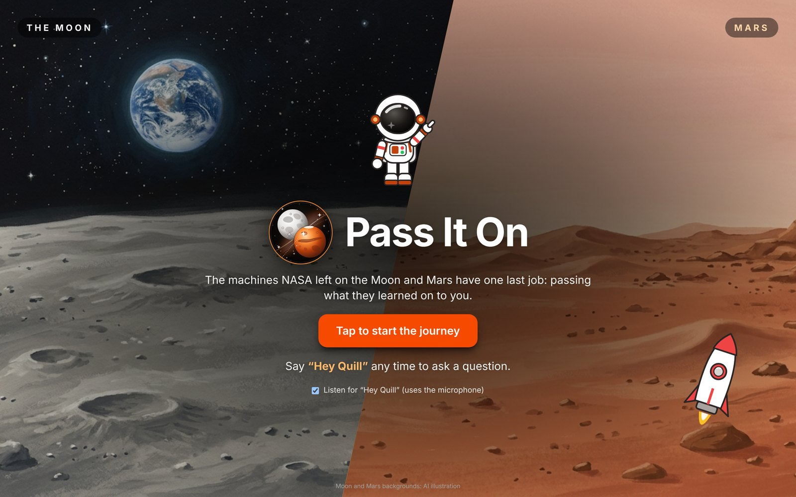
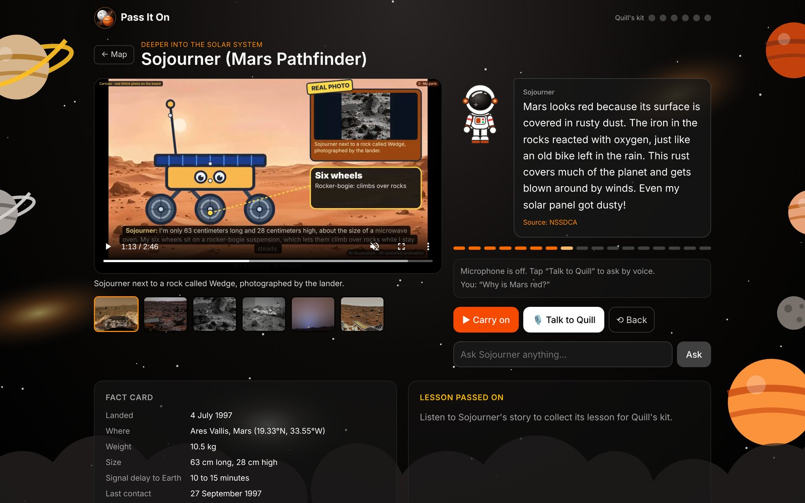
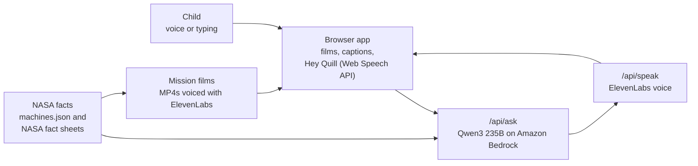

# Pass It On

Pass It On lets the machines NASA left on the Moon and Mars tell their own stories to kids aged 9–13, and kids can stop any story to ask a question by voice.

[Live site](https://passiton-nasa.duckdns.org) · Built for the 2026 NASA Space Apps Challenge · Challenge: *Abandoned but not Forgotten: Storytelling about NASA's Discarded Equipment on the Moon and Mars* · [Slides (PDF)](docs/Pass-It-On-Space-Apps-2026.pdf)



## The problem

Since the 1960s, NASA has left landers, rovers, descent stages and science instruments on the Moon and Mars. Each one made discoveries that today's missions build on. But school-age space fans mostly hear about the missions flying now. To learn about the machines that came before, they have to dig through dense technical websites and history books: dates, ID codes and numbers, with no story to catch a young reader. A record tells you what a machine weighed, not how it worked or what it found. So the machines are forgotten, and so is the science they made possible.

**How might we** turn NASA's records into true stories that kids aged 9–13 want to hear, can question, and can trust?

## What Pass It On does

1. Quill, a rookie astronaut about to launch on a first mission, visits six machines NASA left behind: three on the Moon and three on Mars.
2. Each machine tells its own story in a three-minute animated film with eight chapters: who I am, why NASA sent me, who built me (and what I cost), how I got there, my parts, how my mission worked, what I found, and why I stayed. A real NASA photo sits on a board in each scene, and the captions light up word by word.
3. Kids can interrupt at any time. Saying "Hey Quill" (or typing) pauses the film; the machine answers in its own voice, using only NASA facts, with a link to the source; then the film carries on. "I don't get it" retells the current line in simpler words.
4. Each machine passes one lesson into Quill's kit. With all six, Quill launches toward the next frontier.



## How it works



- The films are pre-made videos: a cartoon drawn in code, voiced with ElevenLabs, with word timings for the live captions.
- For a question, the server sends the model only that machine's NASA facts and NASA's fact sheets for Earth, the Moon and Mars, with strict rules: use only these numbers, say "I'm not sure" when the facts don't say, and keep it short. Every answer comes back with its NASA source.
- The API keys stay in the two server functions, and children's questions are not stored.
- Without any keys it still works, with browser voices and local, fact-only answers.

## The six machines

| Machine | World | What it passes on |
| --- | --- | --- |
| Surveyor 3 | Moon | Test the ground before you send people, and study how machines age in space. |
| Apollo 12 science station (ALSEP) | Moon | Leave science behind that keeps working after people go home. |
| Apollo 15 Lunar Roving Vehicle | Moon | Wheels let explorers go much farther and do more science. |
| Viking 1 and 2 landers | Mars | Land safely, keep things clean, and ask the big question: was Mars ever home to life? |
| Sojourner (Mars Pathfinder) | Mars | Robots far from home must think for themselves, and airbags can make landing cheaper. |
| Spirit and Opportunity | Mars | Solar power and soft sand are real dangers. Plan for dust storms and test the ground before you drive. |

The rest of the challenge's hardware list appears inside these stops: the lunar module descent stages left behind as launch pads (Apollo 12 and 15, plus Apollo 11's Eagle), all three moon buggies (Apollo 15, 16 and 17) and the laser reflectors that are still in use.

## NASA data

All seven links from the challenge's resource list are used:

- [Apollo 11 Lunar Module (Eagle)](https://nssdc.gsfc.nasa.gov/nmc/spacecraft/display.action?id=1969-059C), NSSDCA
- [Apollo 15 Lunar Roving Vehicle](https://nssdc.gsfc.nasa.gov/nmc/spacecraft/display.action?id=1971-063C), NSSDCA
- [Apollo 12 ALSEP science station](https://nssdc.gsfc.nasa.gov/nmc/spacecraft/display.action?id=1969-099C), NSSDCA
- [Surveyor 3](https://science.nasa.gov/mission/surveyor-3/), NASA Science
- [Mars Pathfinder and Sojourner](https://science.nasa.gov/mission/mars-pathfinder/), NASA Science
- [Spirit and Opportunity](https://science.nasa.gov/mission/mars-exploration-rovers-spirit-and-opportunity/), NASA Science
- [Viking 1 and 2](https://science.nasa.gov/mission/viking-1/), NASA Science

On top of these: NSSDCA spacecraft records and fact sheets for Earth, the Moon and Mars, more NASA Science pages (Perseverance, Mars facts, weather on the Moon, Sounds of Mars), NASA History, NASA Space Place, NASA APPEL, the NASA Technical Reports Server, JPL and Goddard. That is 39 NASA pages in all, plus 32 photos, diagrams and drawings from NSSDCA and NASA Science galleries, each with its credit.

There is no NASA API to call for this. The facts and photos were taken from these pages and checked into one file, [`src/data/machines.json`](src/data/machines.json). 90 of the 99 film lines show their NASA source on screen while they play (the other 9 are Quill's questions). When NASA pages disagree (Pathfinder's landing speed is 18 m/s on one page and 14 m/s on another), the film uses one and cites it.

Every picture says what it is, so real and made-up are never confused: *Real photo · NASA*, *Model, photographed on Earth*, *Diagram · NASA*, *Map · NASA landing coordinates*, *Animation · not the real recording*, and *AI illustration · AI-assisted animation* on every film frame.

## Results

Tested on the live site on 15 November 2026:

- Eight test questions (one per machine, plus two tricky ones) were all answered with a NASA source, in 1.1 seconds on average (0.7 to 1.9 seconds).
- Checked against the NASA facts, 7 of the 8 answers were fully correct. One Mars answer used the Moon's night temperature (about −130 °C instead of NASA's −153 °C for Mars). The next fix is to check every number in an answer against the facts before it is spoken.
- "Hey Quill" never went off by mistake: it was tested against all 204 spoken lines, and every 3- to 12-word piece of them, while a film plays.
- It has not yet been tested with a class of children.

## Try it

Open https://passiton-nasa.duckdns.org in Chrome or Edge (no login).

1. Press "Tap to start the journey" and allow the microphone, or untick listening and type instead.
2. Pick a machine on the map.
3. Watch its film, and say "Hey Quill, why is Mars red?" or type in the Ask box.
4. Collect all six lessons to launch Quill.

Voice input works in Chrome and Edge; Safari and Firefox use the Talk button or typing.

## Tech stack

| Part | Technology |
| --- | --- |
| Web app | React 19, TypeScript, Vite, Tailwind CSS |
| Voice input | Web Speech API (Chrome and Edge) |
| Voices | ElevenLabs Text to Speech: pre-made clips with word timings, and live answers |
| Answers | Qwen3 235B on Amazon Bedrock (OpenAI-compatible Mantle endpoint) |
| Painted backgrounds | Google Gemini image generation |
| Server functions and hosting | Vercel |

## Run it yourself

You need Node 20 or later, and Chrome or Edge for voice.

```bash
git clone https://github.com/SHIVANI-PONTURU/Pass-It-On-.git pass-it-on && cd pass-it-on
npm install
npm run dev                    # open http://localhost:5173; works with no keys (browser voices, local answers)
```

To turn on the AI voices and answers:

```bash
cp .env.example .env.local     # add your ELEVENLABS_API_KEY and MANTLE_API_KEY
npm run setup                  # checks the keys, picks the voices and the model, fills in the rest of .env.local
npm run voice                  # records the narration into public/audio (232 clips, skips unchanged lines)
npm run dev
```

- `npm run dev` also runs the `api/` functions, so no Vercel CLI is needed locally.
- To put it online, run `deploy.bat` on Windows (or `node scripts/deploy.mjs`). It builds the site and deploys it to Vercel with the settings from `.env.local`.
- Keys live only in `.env.local` and in Vercel's environment variables, never in code or in Git.

| Variable | Used by | What it is |
| --- | --- | --- |
| `ELEVENLABS_API_KEY` | `scripts/gen-voice.mjs`, `api/speak.ts` | ElevenLabs key (server only) |
| `ELEVENLABS_VOICE_QUILL`, `_MOON`, `_MARS` or `_<MACHINE_ID>` | same | Voice IDs (filled in by `npm run setup`) |
| `MANTLE_API_KEY`, `MANTLE_BASE_URL`, `MANTLE_MODEL` | `api/ask.ts` | The model on Amazon Bedrock |
| `GEMINI_API_KEY` | `scripts/gen-art.mjs` | Gemini image generation for the painted backgrounds |
| `AGENT_ENABLED`, `LIVE_VOICE_ENABLED`, `ASK_PER_MINUTE`, `SPEAK_PER_MINUTE` | `api/` | On/off switches and per-visitor limits |
| `VITE_USE_AGENT`, `VITE_LIVE_VOICE` | browser | `true` to use `/api/ask` and `/api/speak` |

## Repository layout

```text
src/App.tsx               start page, map of the machines, finale
src/components/           machine page, film player, Quill, logo, space backdrop
src/components/cartoon/   the cartoon scenes the films are drawn from
src/engine/               voice input, question handling, answers, narration
src/data/machines.json    every fact, story line, lesson and NASA source
api/                      server functions: ask.ts (answers) and speak.ts (live voice)
public/                   NASA photos, films, narration clips, painted backgrounds, logo
scripts/                  setup, voice and background generation, deploy
docs/                     slides and screenshots
```

## Built with AI tools

- ElevenLabs AI voices narrate the films and read the answers aloud.
- Qwen3 235B on Amazon Bedrock answers kids' questions, using only the NASA facts it is given.
- Google Gemini painted the Moon and Mars backgrounds. They are labelled "AI illustration" on screen, and each one is listed with its model and prompt in `public/art/manifest.json`.
- AI coding assistants helped write the code and the cartoon animation, and helped with research and planning.
- No AI picture contains NASA logos, flags or mission identifiers.

## Accessibility and privacy

Captions are always on, every voice action also has a button or a text box, and it works with a keyboard and screen readers, with a reduced-motion mode and no flashing. There are no accounts and no tracking, and questions are not stored. Chrome's speech recognition sends audio to Google to turn it into text.

## Team

Team Lunars: Shivani Ponturu.

## Credits and license

Photos and data: NASA, NASA/JPL, NASA/JPL-Caltech, NASA/JPL/Cornell and NSSDCA. NASA does not endorse this project. The code is under the [MIT License](LICENSE).
